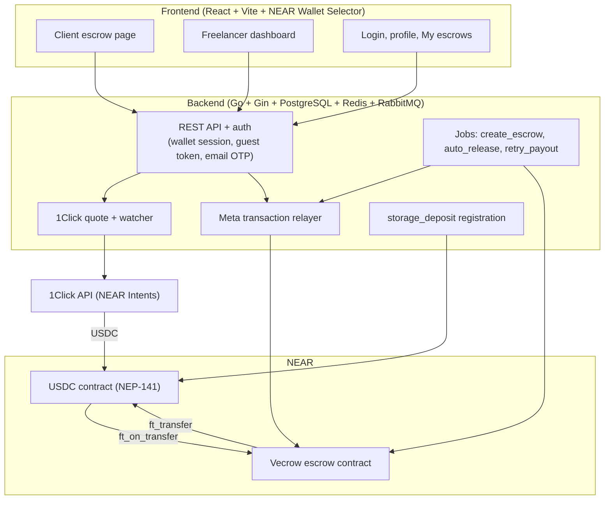
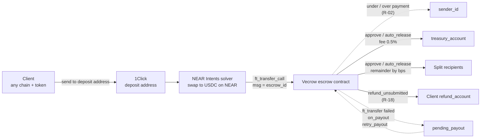
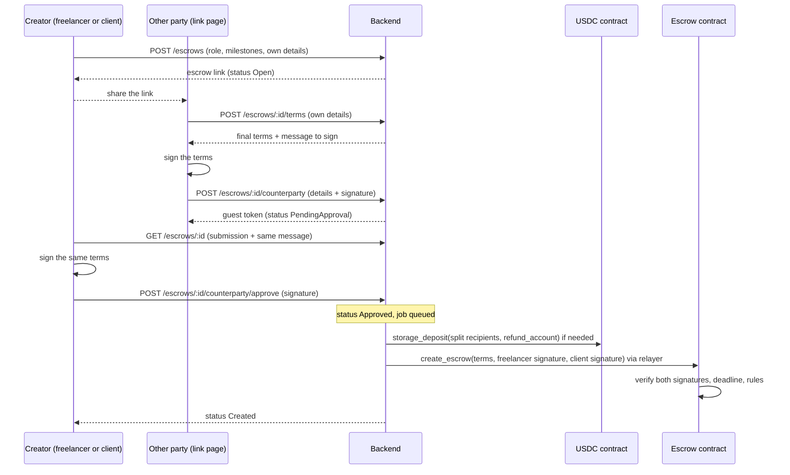
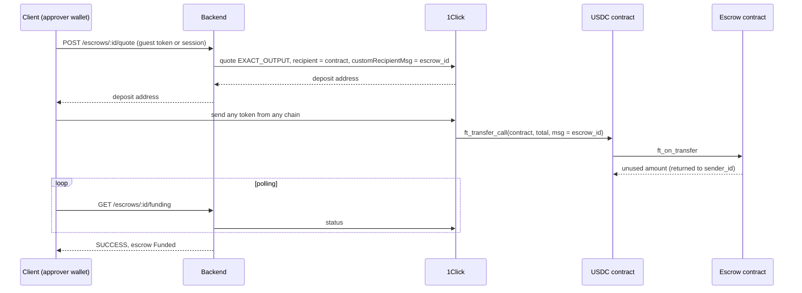
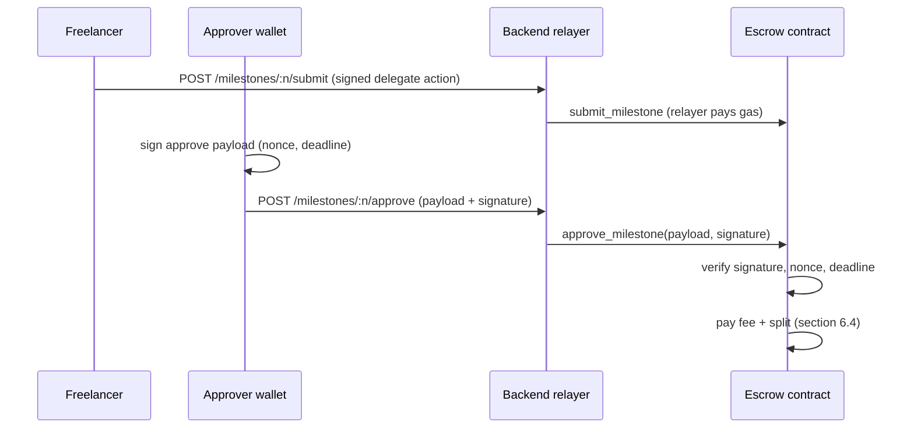
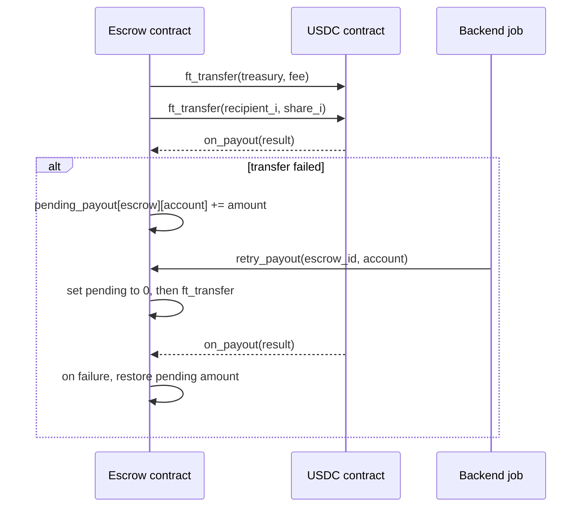

# Vecrow — Architecture

How Vecrow is built. For what it does, see [`spec.md`](./spec.md); for why it is built
this way, see [`decisions.md`](./decisions.md).

## 1. Overview

Vecrow has three parts:

| Part | Responsibility | Holds funds? |
| --- | --- | --- |
| **Escrow contract** (NEAR) | Holds USDC per escrow, verifies the terms both parties signed, enforces milestone rules, verifies signed approvals, pays fee and split | Yes — the only component that does |
| **Backend** | Escrows until they are on-chain (terms, submissions, creator approval) and creating them with `create_escrow`, 1Click quotes and funding watcher, meta transaction relayer, storage registration, scheduled jobs, accounts and CSV export | No (see D-09 for the fallback exception) |
| **Frontend** | Client escrow page, freelancer dashboard, login, profile, "My escrows" | No |

Funds can leave the contract only through contract methods: approval, auto-release,
freelancer refund, or `retry_payout`. An escrow goes on-chain only when both parties
have signed its terms, and the contract checks both signatures itself. The backend
pays gas and `storage_deposit` in NEAR, but never decides where USDC goes or who
approves.

## 2. Repository layout

```text
.
├── contracts/   # Rust, near-sdk — the escrow contract and its tests
├── backend/     # Go — REST API, relayer, 1Click watcher, jobs
├── frontend/    # React + Vite — escrow pages, dashboard, account pages
└── docs/        # spec.md, architecture.md, decisions.md
```

## 3. Components



| Layer | Technology | Notes |
| --- | --- | --- |
| Contract | Rust, near-sdk, cargo-near, near-workspaces | Unit and integration tests run against a mock NEP-141 token on a local sandbox / testnet |
| Backend | Go (Gin), PostgreSQL, Redis, RabbitMQ | 1Click is called over its REST API; NEAR transactions (relayer, `storage_deposit`, jobs) are sent over NEAR JSON-RPC. Jobs (escrow creation, funding watcher, auto-release, payout retry) are queued in RabbitMQ and processed by workers. Redis holds short-lived state with a TTL (login nonces, sessions, OTP rate limits). Layering in section 7.4 |
| Frontend | React, Vite, NEAR Wallet Selector | Single-page app that talks only to the backend API. EVM and Solana wallets are only needed for signing; paying is a transfer to a deposit address from any wallet |

## 4. Money flow



Every arrow out of the contract is an `ft_transfer` on the USDC contract, followed by
the `on_payout` callback (section 6.4).

## 5. Escrow contract

### 5.1 Methods

| Method | Caller | Effect | Requirements |
| --- | --- | --- | --- |
| `create_escrow` | Relayer, with the freelancer's and the client's signatures | Verifies both signatures over the same terms; stores freelancer, milestones, split, approver, `refund_account`, review window, and `fee_bps`; status `Created` | R-01, R-03, R-04, R-19, R-23 |
| `cancel` | Freelancer (via relayer), or relayer with the approver's signature | `Created` → `Cancelled` | R-01 |
| `ft_on_transfer` | USDC contract | Applies the funding amount rules; `Created` → `Funded` | R-02 |
| `submit_milestone` | Freelancer (via relayer) | `Pending` / `RevisionRequested` → `Submitted`; starts the review window | R-05 |
| `approve_milestone` | Relayer, with the approver's signature | `Submitted` → `Released`; pays fee and split | R-06, R-19 |
| `request_revision` | Relayer, with the approver's signature | `Submitted` → `RevisionRequested`; increments `revision_count` (max 2) | R-17 |
| `auto_release` | Anyone (backend job) | `Submitted` → `Released` after the review window | R-07 |
| `refund_unsubmitted` | Freelancer (via relayer) | `Pending` → `Refunded`; pays `refund_account` | R-18 |
| `on_payout` | Contract callback | Records failed transfers in `pending_payout` | R-20 |
| `retry_payout` | Anyone (backend job) | Re-sends a pending payout | R-20 |
| `get_escrow` | Anyone (view) | Escrow, milestones, approver, pending payouts | — |

The escrow becomes `Completed` when every milestone is `Released` or `Refunded`.
Escrows that are not on-chain yet (`Open`, `PendingApproval`, `Approved`) exist only in
the backend (section 6.1); the contract never sees them.

### 5.2 State

| Item | Contents |
| --- | --- |
| Configuration | USDC contract ID, `treasury_account`, default `fee_bps`, review window (set at deploy) |
| Escrows | Freelancer, split, approver, `refund_account`, and locked `fee_bps` (all fixed by `create_escrow`); milestones (amount, status, last submit time, `revision_count`); status |
| Used nonces | Per approver, to reject replayed signatures |
| `pending_payout` | `escrow_id → account → amount` for transfers that failed |

### 5.3 Signature verification

The contract verifies two kinds of signed payload:

- **Escrow terms** (`create_escrow`): escrow ID, freelancer, milestones, split,
  approver scheme and address, `refund_account`, `fee_bps`, and a deadline. Both
  parties sign the same terms: the freelancer with NEP-413 from their NEAR account, the
  client with the approver's scheme. The backend builds the message, so both
  signatures cover the same bytes. The contract rejects an expired deadline and an
  escrow ID that already exists, so signed terms cannot be replayed.
- **Actions** (approve, request revision, cancel by the client): escrow ID, milestone
  (for approve and revision), action, nonce, and deadline, signed by the approver. The contract rejects reused
  nonces and expired deadlines.

Each signature is checked for its scheme:

| Scheme | Wallets | Verification |
| --- | --- | --- |
| NEP-413 | NEAR wallets | ed25519 over the NEP-413 message format |
| EIP-191 | MetaMask and other EVM wallets | keccak256 of the prefixed message, `ecrecover`, compare with the approver address |
| ed25519 | Phantom and other Solana wallets | ed25519 over the raw message bytes |

## 6. Key flows

### 6.1 Escrow proposal and creation on-chain



The details each party adds depend on their role, not on who created the escrow: the
freelancer always provides their NEAR account and the split, and the client always
provides the approver wallet and `refund_account`. If the creator rejects the
submission, or its deadline passes, the escrow returns to `Open` and the same link can
be used again. If `create_escrow` is rejected, for example because the deadline passed
before the job ran, the escrow also returns to `Open`.

### 6.2 Funding from another chain

Funding starts once the escrow is `Created` (section 6.1). The client proves the
approver wallet with the guest token from joining (R-21) or with a session that
includes that wallet.



If the mainnet test shows `customRecipientMsg` is not reliable, 1Click delivers to a
backend account instead, and the backend calls `ft_transfer_call` itself (D-09).

### 6.3 Gasless submit and approve



The relayer only submits transactions whose receiver is the Vecrow contract. It does
not sign approvals or terms, and cannot change a payload without invalidating the
signature.

### 6.4 Payout with retry



Zeroing the pending amount before sending, and restoring it only on failure, means
two retries in a row cannot pay twice.

## 7. Backend

### 7.1 Modules

| Module | Responsibility | Requirements |
| --- | --- | --- |
| API | REST endpoints listed in `spec.md` section 7 | — |
| Auth | Wallet login (nonce + signature), sessions, guest tokens, email OTP recovery | R-13, R-14, R-21, R-22 |
| Escrows | Escrows until they are on-chain (terms, the other party's submission, creator approval or rejection), invitations, role queries, revision notes | R-15, R-16, R-17, R-23 |
| 1Click | Token list, quotes, funding status watcher | R-08 |
| Relayer | Forwards signed actions and approved escrow terms to the Vecrow contract and pays gas | R-09, R-23 |
| Storage | `storage_balance_of` checks and `storage_deposit` registration | R-20 |
| Jobs | `create_escrow` for approved escrows, `auto_release` when the window ends, `retry_payout` for pending payouts | R-07, R-20, R-23 |
| Export | CSV export, one row per payout, fee as its own row | R-12 |

### 7.2 Data

PostgreSQL stores what the contract does not need, or does not have yet: escrows
before they go on-chain (terms, the other party's submission, and both signatures),
accounts, linked wallets and emails, invitations, revision notes, 1Click quotes and
funding status, and an index of payouts and transaction hashes for the dashboard and
CSV export. Once an escrow is on-chain, the contract is the source of truth for its
balances and statuses; the backend reads them from the contract.

### 7.3 Jobs

| Job | Trigger | Action |
| --- | --- | --- |
| Escrow creation | The creator approved (`Approved`) | Ensures storage registration, then calls `create_escrow` with both signatures; marks the escrow `Created`, or returns it to `Open` if the contract rejects the terms |
| Funding watcher | After a quote | Polls 1Click until `SUCCESS` or `REFUNDED` |
| Auto-release | Review window ended for a `Submitted` milestone | Calls `auto_release` |
| Payout retry | `pending_payout` is non-empty | Ensures registration, then calls `retry_payout` |

A scheduler in the backend periodically finds due work in PostgreSQL (approved escrows
not yet on-chain, quotes still pending, milestones whose review window has ended,
pending payouts) and publishes a message per item to RabbitMQ. Workers consume the
messages and call 1Click or the contract. Failed messages are retried with a delay:
each topic has a retry queue whose TTL is `QUEUE_RETRY_DELAY`. After
`QUEUE_MAX_RETRIES` retries, or on an error marked permanent (such as a malformed
payload), the message moves to the topic's dead-letter queue.

Queue topology for a topic `T` (all durable):

- Exchange `vecrow.jobs` (direct) routes key `T` to queue `T`.
- Queue `T.retry` has `x-message-ttl=QUEUE_RETRY_DELAY` and dead-letters back to the exchange with key `T`.
- Queue `T.dlq` holds messages that failed permanently or exhausted their retries.

A failed message is re-published to `T.retry` with `x-attempt` + 1 and the original is
acked; when the TTL expires, RabbitMQ routes it back to `T`. If a handler hits its
timeout, the message is settled the same way. Changing `QUEUE_RETRY_DELAY` for an
existing topic requires deleting `T.retry` first, because RabbitMQ rejects re-declaring
a queue with different arguments.

All jobs are idempotent: running one twice has the same effect as running it once,
because the contract rejects calls that are not valid for the current state. When
`create_escrow` reports that the escrow ID already exists, the creation job reads it
with `get_escrow` and marks it `Created`. This makes RabbitMQ's at-least-once delivery
safe.

### 7.4 Code structure

The backend follows clean architecture with manual constructor injection (D-12).
Dependencies point inward:

| Layer | Package | Depends on |
| --- | --- | --- |
| Domain | `internal/domain` | Standard library only |
| Use cases | `internal/usecase/...` | Domain, and the ports (interfaces) each use case declares |
| Repositories | `internal/repository` | Use-case ports, generic infrastructure interfaces |
| Delivery | `internal/delivery/http` (Gin), `internal/delivery/worker` (queue consumers) | Use cases, through interfaces |
| Infrastructure | `internal/infrastructure/{database,cache,queue,logger}` | Driver libraries |
| Composition root | `internal/bootstrap`, `cmd/api`, `cmd/worker` | Everything; the only place concrete technologies are chosen |

Infrastructure packages are named after their role, not their technology.
`cache.Store`, `queue.Publisher` and `queue.Subscriber` are generic interfaces.
PostgreSQL, Redis and RabbitMQ appear only in the implementation files
(`database/postgres.go`, `cache/redis.go`, `queue/rabbitmq.go`) and in `bootstrap`.
One exception: `database.Querier` uses pgx types, because it must match the `DBTX`
interface that sqlc generates for pgx. Repositories built on sqlc therefore depend on
pgx too, and replacing PostgreSQL also means regenerating them.

Logging uses `log/slog`: JSON in production, text in development. Every record about an
HTTP request or a queue message carries its `request_id`, which is passed from the
`X-Request-ID` header into queue message headers. Errors are logged once, by the boundary
that handles them (HTTP access log, queue consumer, scheduler). Request bodies, query
strings, tokens, signatures and OTP codes are never logged; as a safety net, attributes
with sensitive keys are redacted.

### 7.5 Wallet login (R-13, R-14)

Login and wallet linking use the same challenge (D-13):

1. `POST /auth/nonce {scheme, address}` returns `{nonce, message, recipient, expires_at}`.
   `scheme` is `eip191` (EVM), `ed25519` (Solana) or `nep413` (NEAR). The nonce is valid
   for `AUTH_NONCE_TTL` and can be used once.
2. The wallet signs `message` exactly as returned. It is plain text:

   ```
   {AUTH_DOMAIN} wants you to sign in with your wallet.

   Wallet: {address}
   Nonce: {nonce}
   Expires: {expires_at}

   Signing is free and does not send a transaction.
   ```

3. `POST /auth/verify {nonce, signature, public_key?}` logs in and returns
   `{token, expires_at, new_account, account}`. The first login creates the account with a
   generated username (`user_xxxxxxxx`), which `PATCH /me` can change. With a session,
   `POST /me/wallets` takes the same body and links the wallet to the account instead.

| Scheme | Wallet call | `signature` | `public_key` |
| --- | --- | --- | --- |
| `eip191` | `personal_sign(message)` | hex, `0x` + 65 bytes | — |
| `ed25519` | `signMessage(utf8 bytes of message)` | base58, 64 bytes | — |
| `nep413` | `signMessage({message, nonce: hex-decoded nonce (32 bytes), recipient})`, no `callbackUrl` | base64, 64 bytes | `ed25519:<base58>` |

For NEAR, the backend also checks over RPC (`NEAR_RPC_URL`) that `public_key` is a full
access key of the account, because a NEAR account ID is a name, not a key. An implicit
account (64 hex characters) that is not yet on chain is accepted when it is the hex of
`public_key`, so users with a NEAR balance of 0 can log in.

The token is sent as `Authorization: Bearer <token>` to `/me` and `/auth/logout`. It is an
opaque random string; Redis stores only its SHA-256, with the `AUTH_SESSION_TTL` expiry.
A wallet belongs to at most one account (`UNIQUE (scheme, address)`), and the last wallet
of an account cannot be unlinked.

## 8. Trust boundaries

| Actor | Can | Cannot |
| --- | --- | --- |
| Freelancer | Create an escrow or join one, choose and sign their account and the split, approve or reject the client's submission when they created the escrow, cancel before funding, submit, refund `Pending` milestones | Approve milestones, choose or change the approver, take funds for itself outside the split |
| Client (approver) | Create an escrow or join one, choose and sign the approver and `refund_account`, approve or reject the freelancer's submission when they created the escrow, cancel before funding, approve, request up to 2 revisions | Choose the split, refund, change the approver after the escrow is on-chain, hold funds beyond the review window |
| Anyone | Call `auto_release` after the window, `retry_payout` | Change where funds go |
| Relayer | Pay gas for calls to the Vecrow contract, including `create_escrow` | Approve, forge or alter signed payloads or terms, call other contracts |
| Backend | Store escrows until they are on-chain, create on-chain the escrows both parties signed, register storage, run jobs, manage accounts | Change signed terms, create an escrow without both signatures, move USDC (except under the D-09 fallback) |
| Account / session | Show escrows, act as a login, start an escrow | Grant any right in the contract |

## 9. Networks and configuration

| Environment | Contract | Token | Funding |
| --- | --- | --- | --- |
| Local / testnet | Deployed from `contracts/` | Mock NEP-141 token | Direct `ft_transfer_call`; 1Click quotes with `dry: true` |
| Mainnet (demo) | Separate development account | USDC (contract ID from the 1Click token list) | 1Click with small amounts |

Configuration such as RPC URL, contract and treasury account IDs, the relayer and
backend keys, the PostgreSQL and RabbitMQ URLs, the 1Click API settings, the review
window, and the signing deadline for escrow terms is read from environment variables.
Every variable is listed in the `.env.example` file of `backend/` and `frontend/`
without real values; keys are never committed.
