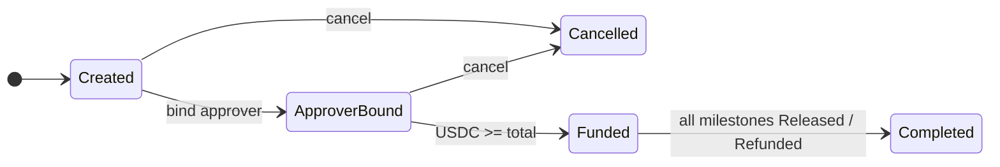
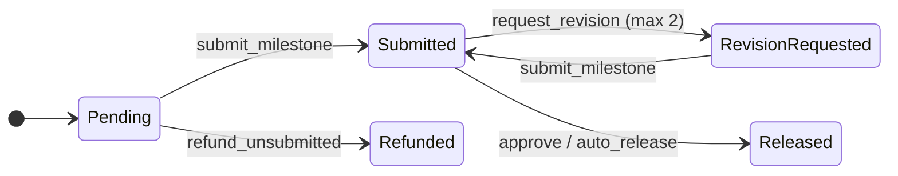

# Vecrow — Product Specification

Milestone escrow with automatic revenue split for cross-border freelancers and agencies.
Built at NEAR HACKATHON (Nov 2026) · Track: Real-World Money (`realworld`)

This document is the source of truth for **what Vecrow does**. Each requirement
(`R-xx`) has acceptance criteria, an implementation status, and links to the code
and tests that verify it. For **how** it is built, see
[`architecture.md`](./architecture.md). For the reasoning behind key choices, see
[`decisions.md`](./decisions.md).

## How to read this document

| Status | Meaning |
| --- | --- |
| Implemented | All acceptance criteria are met and covered by the linked tests |
| Partial | Some acceptance criteria are met; the gap is described in the requirement |
| Cut | Not built for the hackathon; listed under [Limitations](#9-limitations) |

- **Code** and **Tests** columns link to files in this monorepo.
- Contract methods are written as `method_name`; HTTP endpoints as `METHOD /path`.
- Status names are identical in the contract, the API, and this document (see [Status model](#6-status-model)).

## 1. Summary

A client pays a freelancer or agency from any chain and token. Funds are locked in
an escrow contract on NEAR. Each approved milestone is released as USDC, minus a
0.5% platform fee, and the remainder is split automatically between team members.
Neither the freelancer nor the client needs to hold NEAR for gas.

**Problems addressed**

- Clients do not want to pay upfront; freelancers do not want to deliver without a guarantee of payment.
- Agencies receive one payment and split it by hand across members in different countries.
- Existing crypto escrows require both parties to use the same chain.

## 2. Goals and non-goals

**Goals**

1. A client funds an escrow from any supported chain through NEAR Intents (1Click API), without manual bridging.
2. Funds leave the contract only through contract rules: approval, auto-release, cancellation before funding, or a freelancer-initiated refund of unsubmitted milestones.
3. Every released milestone is charged a 0.5% platform fee; the rest is split between team accounts by basis points.
4. Freelancers and clients complete the full flow with a NEAR balance of 0.
5. Clients approve with a wallet they already own: NEAR, EVM, or Solana.

**Non-goals (MVP)**

Third-party arbitration · fiat off-ramp · tokens other than USDC · KYC · cross-chain
refunds after funding · recovering contract rights (submit, approve, payouts) when a
wallet is lost · outright rejection of a milestone by the client.

## 3. Roles and user stories

**Freelancer / team lead**

- Creates an escrow with several USDC milestones and receives a payment link for the client.
- Configures a per-escrow split (e.g. 70/30) so each member is paid automatically.
- Submits milestones without holding NEAR.
- Is paid automatically if the client does not respond within 14 days of the latest submission; the client can request at most 2 revisions per milestone, so funds cannot be held indefinitely.
- Cancels an unfunded escrow and exports a CSV for an accountant.
- Refunds unsubmitted milestones to the client if the project stops midway.
- Links the client to the escrow by username, email, or wallet address so it appears in the client's account.

**Client / approver**

- Pays from the chain and token they already hold, straight from the link, without creating an account.
- Binds their own wallet as the sole approver before paying, and sets the NEAR account that receives refunds.
- Sees live funding status with transaction links.
- Approves a milestone, or requests a revision (max 2 per milestone), by signing with their wallet, without paying gas.
- Is warned if the escrow is already bound to a different wallet.
- After funding, is offered to save the escrow to an account using the same wallet.

**Team member (agency split recipient)**

- Receives their USDC share directly when a milestone is released, with a transaction link.

**Any user (accounts)**

- Signs up and logs in by signing with an existing wallet (NEAR, EVM, or Solana); no password.
- Links several wallets and an optional email to one account.
- Recovers the account through an email OTP if their wallet is lost, then links a new wallet.
- Acts as freelancer in one escrow and as client in another with the same account.

## 4. Requirements overview

| ID | Requirement | Layer | Status | Code | Tests |
| --- | --- | --- | --- | --- | --- |
| R-01 | Create and cancel escrow | Contract | Planned | | |
| R-02 | Funding and amount rules | Contract | Planned | | |
| R-03 | Revenue split | Contract | Planned | | |
| R-04 | Bind approver and refund account | Contract | Planned | | |
| R-05 | Submit milestone | Contract | Planned | | |
| R-06 | Signed approval (NEAR, EVM, Solana) | Contract | Planned | | |
| R-07 | Auto-release after 14 days | Contract + job | Planned | | |
| R-08 | Cross-chain funding via 1Click | Backend | Planned | | |
| R-09 | Gasless meta transaction relayer | Backend | Planned | | |
| R-10 | Client payment page | Frontend | Planned | | |
| R-11 | Freelancer dashboard | Frontend | Planned | | |
| R-12 | CSV export | Backend | Planned | | |
| R-13 | Wallet sign-up and login | Backend + frontend | Planned | | |
| R-14 | Profile, multiple wallets, email | Backend + frontend | Planned | | |
| R-15 | Link client to escrow | Backend | Planned | | |
| R-16 | "My escrows" page | Backend + frontend | Planned | | |
| R-17 | Request milestone revision | Contract | Planned | | |
| R-18 | Refund by freelancer | Contract | Planned | | |
| R-19 | 0.5% platform fee | Contract | Planned | | |
| R-20 | Storage registration and payout retry | Contract + backend | Planned | | |
| R-21 | Pay without an account (guest token) | Backend + frontend | Planned | | |
| R-22 | Account recovery via email OTP | Backend + frontend | Planned | | |

## 5. Requirements and acceptance criteria

### Contract

#### R-01 — Create and cancel escrow

`create_escrow` stores the freelancer, milestones, split, and review window.
`cancel` is allowed only before the escrow is funded.

- [ ] near-workspaces unit tests pass for `create_escrow` and `cancel`.
- [ ] `cancel` on a `Funded` escrow is rejected.

#### R-02 — Funding and amount rules

Funds arrive through `ft_on_transfer` from the USDC contract with `msg = escrow_id`.
Refunds of incoming transfers follow NEP-141, so they return to `sender_id`.

- [ ] Transfer of exactly the total → escrow becomes `Funded` with a balance equal to the total.
- [ ] Transfer below the total → returned in full; status unchanged.
- [ ] Transfer above the total → escrow is `Funded` with exactly the total; the excess (`amount - total`) is returned.
- [ ] Transfer to an escrow that is `Created` (no approver yet), `Funded`, `Completed`, or `Cancelled` → returned in full.
- [ ] Transfer of any other token, or with an unknown `escrow_id` → rejected and returned.

#### R-03 — Revenue split

A list of `{account, bps}` that sums to exactly 10,000, applied to the milestone
amount after the platform fee (R-19). Recipients are registered on the USDC
contract by the backend (R-20). Any rounding remainder goes to the first recipient.

- [ ] A split that does not total 10,000 bps is rejected.
- [ ] With 2 and 3 recipients, each receives the correct share.

#### R-04 — Bind approver and refund account

Before funding, the client signs once. The payload contains the signature scheme,
the approver address, and a `refund_account` (NEAR account). All are locked once
the escrow is `Funded`.

- [ ] A second bind attempt is rejected.
- [ ] An approver equal to the freelancer or a split recipient is rejected.
- [ ] `refund_account` is required and may not equal the freelancer or a split recipient.

#### R-05 — Submit milestone

The freelancer submits a milestone, which starts its review window.

- [ ] Only the freelancer can submit.
- [ ] Only milestones in `Pending` or `RevisionRequested` on a `Funded` escrow can be submitted.
- [ ] Re-submitting starts a new review window.

#### R-06 — Signed approval

The approver approves a milestone with a signed payload containing a nonce and a
deadline. Supported schemes: NEAR (NEP-413), EVM (EIP-191 with `ecrecover`), and
Solana (ed25519).

- [ ] Approval succeeds when signed from a NEAR wallet, MetaMask, and Phantom.
- [ ] A reused nonce is rejected.
- [ ] An expired payload is rejected.

#### R-07 — Auto-release

Anyone may call `auto_release` once 14 days have passed since the latest
submission. A backend job calls it automatically.

- [ ] Rejected before the window ends.
- [ ] The window is measured from the latest submission.
- [ ] Rejected for milestones in `RevisionRequested`.
- [ ] The window is configurable at deploy time (shortened for the demo).

#### R-17 — Request milestone revision

`request_revision` is signed by the approver (same schemes, nonce, and deadline as
R-06) and forwarded by the relayer. Only for `Submitted` milestones; the status
becomes `RevisionRequested` and the auto-release timer stops. The contract stores
`revision_count` per milestone, max 2. The reason text is stored in the backend,
not on-chain.

- [ ] A third revision request is rejected.
- [ ] A revision request not signed by the approver is rejected.
- [ ] A revision request for a `Pending` or `Released` milestone is rejected.
- [ ] After re-submission, `auto_release` is only callable 14 days later.

#### R-18 — Refund by freelancer

The freelancer calls `refund_unsubmitted` (via the relayer) for one or all
`Pending` milestones of a `Funded` escrow. The USDC is sent to the
`refund_account` from R-04 and the milestone becomes `Refunded`. The client cannot
trigger a refund.

- [ ] Only the freelancer can call it.
- [ ] Milestones in `Submitted`, `RevisionRequested`, or `Released` are rejected.
- [ ] `refund_account` is registered by the backend at bind time (R-20).
- [ ] The escrow becomes `Completed` once every milestone is `Released` or `Refunded`.

#### R-19 — Platform fee 0.5%

`fee_bps = 50` is locked per escrow at `create_escrow`. On every release (approve or
`auto_release`), `fee = floor(amount × fee_bps / 10,000)` is sent to
`treasury_account`; the rest is split per R-03. Refunds (R-18) and returned
deposits (R-02) are not charged. The fee is shown on the freelancer dashboard and
the client payment page.

- [ ] A 1,000 USDC milestone with a 70/30 split pays 5 to treasury, 696.5 and 298.5 to the recipients.
- [ ] The total paid out equals the milestone amount exactly.
- [ ] Refunds are not charged a fee.
- [ ] Changing the fee configuration does not affect escrows that already exist.
- [ ] `treasury_account` is registered via `storage_deposit` at deploy time.

#### R-20 — Storage registration and payout retry

The escrow contract and `treasury_account` are registered on the USDC contract at
deploy time. The backend checks `storage_balance_of` and, if needed, pays
`storage_deposit` (`registration_only = true`) from a backend account: split
recipients before `create_escrow`, `refund_account` before bind. Clients funding
through 1Click need no registration. Every payout (release, fee, refund) uses
`ft_transfer` with an `on_payout` callback; a failed transfer is recorded in
`pending_payout[escrow][account]`. Anyone may call `retry_payout(escrow_id, account)`
and a backend job runs it automatically. The pending balance is zeroed before
sending and restored if the transfer fails again.

- [ ] A transfer to an unregistered account is recorded as pending, not lost.
- [ ] `retry_payout` after registration sends the exact pending amount.
- [ ] Two consecutive `retry_payout` calls do not pay twice.
- [ ] Pending payouts appear in `GET /escrows/:id` and in the CSV export.
- [ ] Freelancer and client still need a NEAR balance of 0.

### Backend

#### R-08 — Cross-chain funding via 1Click

The backend requests a 1Click `EXACT_OUTPUT` quote with `recipient` = escrow
contract and `customRecipientMsg` = `escrow_id`. Only available to the approver
wallet. The list of supported tokens comes from 1Click.

- [ ] The deposit address is shown only to the approver, proven by a guest token (R-21) or a session that includes the approver wallet.
- [ ] Funding status is tracked until `SUCCESS`.

#### R-09 — Gasless relayer

A meta transaction relayer pays gas only for calls to the Vecrow contract and only
forwards signed payloads.

- [ ] The full flow works with a NEAR balance of 0.
- [ ] Calls to any other contract are rejected.

#### R-12 — CSV export

Columns: date, escrow, milestone, USDC amount, recipient, tx hash, status. The
platform fee is a separate row with the treasury as recipient.

- [ ] One row per payout.
- [ ] Opens cleanly in a spreadsheet without manual cleanup.

#### R-13 — Wallet sign-up and login

The backend issues a nonce; the user signs a login message (NEP-413, EIP-191, or
ed25519). The first login creates an account with a unique username. Sessions are
expiring tokens.

- [ ] A reused nonce or an invalid signature is rejected.
- [ ] A second login with the same wallet opens the same account.
- [ ] A duplicate username is rejected.

#### R-14 — Profile, multiple wallets, email

An account can link additional wallets (each proven by its own signature) and an
optional email verified by OTP.

- [ ] A wallet already owned by another account is rejected.
- [ ] An unverified email is not used to match client invitations.

#### R-15 — Link client to escrow

When creating an escrow, the freelancer may name the client by username, email, or
wallet address. Invitations to an email or wallet not yet registered are stored and
linked automatically when the owner registers or links it. **The link grants
visibility only**: it does not set, restrict, or replace the approver (R-04 still
applies).

- [ ] The escrow appears in the invited client's account.
- [ ] Binding the approver still requires the client's signature.
- [ ] If the bound approver is not a wallet of the invited client's account, the escrow page warns the client.

#### R-16 — "My escrows"

Lists the account's escrows grouped by role: freelancer, client (invited, or
approver bound to one of the account's wallets), and split member. Filterable by
status.

- [ ] The list matches role and status.
- [ ] The endpoint requires a valid session.

#### R-21 — Pay without an account (guest token)

The payment page does not require login. After verifying the bind signature
(R-04), the backend issues a guest token tied to one escrow and one approver
wallet, valid for 24 hours. It is used for quotes, funding status, and escrow
details, and can be renewed by signing a new nonce with the approver wallet.
Approvals and revisions are still verified by the contract from signatures, never
from the token. After funding, the client is offered "Save to account" via R-13
login with the same wallet.

- [ ] Binding the approver returns a guest token.
- [ ] A token used for another escrow or another wallet is rejected.
- [ ] An expired token is rejected and can be renewed with a signature.
- [ ] A quote without a guest token or approver session is rejected.
- [ ] Logging in with the approver wallet shows the escrow under the client role.

#### R-22 — Account recovery via email OTP

An account with a verified email (R-14) can log in with a 6-digit OTP valid for 10
minutes, max 5 attempts, rate-limited per email. Unknown emails do not create
accounts. An email session is recovery-only: view the account, link a new wallet
(still proven by its signature), and unlink old wallets. Other actions (create
escrow, change client invitation, change email) require a wallet session. Each
wallet linked through an email session triggers a notification email. Recovery
does not restore contract rights.

- [ ] A wrong, expired, or over-limit OTP is rejected.
- [ ] An unverified email cannot log in.
- [ ] An email session is rejected by `POST /escrows` and `PATCH /escrows/:id/client`.
- [ ] A newly linked wallet can log in normally.
- [ ] The notification email is sent.

### Frontend

#### R-10 — Client payment page

Escrow summary, connect wallet, bind approver, deposit address, live status,
approve and request-revision actions, fee display.

- [ ] Usable without login (R-21).
- [ ] A non-approver wallet sees a warning instead of the deposit address.

#### R-11 — Freelancer dashboard

Create escrow and split, copy the payment link, invite the client, submit
milestones, refund `Pending` milestones, view status, fees, pending payouts, and
transaction links.

- [ ] One complete flow can be demonstrated end to end.

## 6. Status model

Contract enums are serialized as PascalCase strings. The API and this document use
the same strings with no mapping (e.g. `{"status": "Funded"}`).

| `EscrowStatus` | Meaning |
| --- | --- |
| `Created` | Created; no approver and no funds yet |
| `ApproverBound` | Approver bound; waiting for funds |
| `Funded` | USDC received; approver locked |
| `Completed` | Every milestone is `Released` or `Refunded` |
| `Cancelled` | Cancelled before funding |

| `MilestoneStatus` | Meaning |
| --- | --- |
| `Pending` | Not submitted yet |
| `Submitted` | 14-day review window running |
| `RevisionRequested` | Client requested a revision (max 2); timer paused until re-submission |
| `Released` | Paid out to treasury and split recipients |
| `Refunded` | Returned to the client's `refund_account` by the freelancer |

1Click funding status (`PENDING`, `SUCCESS`, `REFUNDED`) is separate and appears
only in `GET /escrows/:id/funding`.

## 7. API surface

| Endpoint | Purpose | Requirements |
| --- | --- | --- |
| `GET /tokens` | Supported source chains and tokens (from 1Click) | R-08 |
| `POST /escrows` | Create escrow (milestones, split, optional client); wallet session required | R-01, R-03, R-15 |
| `GET /escrows/:id` | Escrow details, approver, milestone status, fee, pending payouts, tx links | R-10, R-11, R-20 |
| `POST /escrows/:id/cancel` | Cancel before funding | R-01 |
| `PATCH /escrows/:id/client` | Change client invitation before funding | R-15 |
| `POST /escrows/:id/approver` | Bind approver + `refund_account`; returns guest token | R-04, R-21 |
| `POST /escrows/:id/guest-token` | Renew guest token with an approver signature | R-21 |
| `POST /escrows/:id/quote` | 1Click quote (approver only) | R-08 |
| `GET /escrows/:id/funding` | Funding status: `PENDING`, `SUCCESS`, `REFUNDED` | R-08, R-10 |
| `POST /escrows/:id/milestones/:n/submit` | Submit milestone via relayer | R-05, R-09 |
| `POST /escrows/:id/milestones/:n/approve` | Forward signed approval via relayer | R-06, R-09 |
| `POST /escrows/:id/milestones/:n/revision` | Forward signed revision request + reason | R-17, R-09 |
| `POST /escrows/:id/refund` | Refund `Pending` milestones via relayer | R-18, R-09 |
| `GET /escrows/:id/export.csv` | CSV export | R-12 |
| `POST /auth/nonce`, `POST /auth/verify`, `POST /auth/logout` | Wallet login and session | R-13 |
| `POST /auth/email/otp`, `POST /auth/email/verify` | Recovery login via email OTP | R-22 |
| `GET /me`, `PATCH /me` | View and edit profile | R-13, R-14 |
| `POST /me/email/verify` | Verify email with OTP | R-14 |
| `POST /me/wallets`, `DELETE /me/wallets/:id` | Link and unlink wallets | R-14, R-22 |
| `GET /me/escrows?role=freelancer\|client\|member` | Escrows by role | R-16 |

`auto_release` (R-07) and `retry_payout` (R-20) have no endpoint; backend jobs call
them directly on the contract.

## 8. Non-functional requirements

- Funds leave the escrow only through contract methods.
- Every approval and revision carries a nonce and a deadline.
- No secrets in the repository; configuration is documented in `.env.example`.
- Watchers and jobs are idempotent; no payout is sent twice.
- Accounts are backend identity and visibility only; the contract never treats an account as proof of approval rights.
- Session tokens, guest tokens, and OTP codes are never stored in the repository or written to logs.

## 9. Limitations

- No third-party arbitration; a client cannot reject a milestone outright (max 2 revisions, then auto-release).
- USDC only; no fiat off-ramp; no KYC.
- Refunds are sent to a NEAR account (`refund_account`), not back to the client's original chain.
- Over- or under-payment returns go to `sender_id` per NEP-141; on the 1Click path this is the account that called `ft_transfer_call`, not the client's source wallet. `EXACT_OUTPUT` quotes keep this difference near zero.
- The contract cannot prove that the approver wallet is not a second wallet owned by the freelancer; the payment page shows the bound approver and warns the client not to pay if it is not theirs.
- A lost wallet cannot recover contract rights (submit, approve, payouts). Email recovery (R-22) restores the account only.
