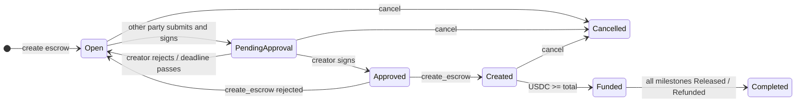
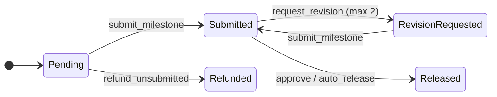

# Vecrow — Product Specification

Milestone escrow with automatic revenue split for cross-border freelancers and agencies.
Built at NEAR HACKATHON (Nov 2026) · Track: Real-World Money (`realworld`)

This document is the source of truth for **what Vecrow does**. Each requirement
(`R-xx`) has acceptance criteria, an implementation status, and links to the code
and tests that verify it. For **how** it is built, see
[`architecture.md`](./architecture.md). For the reasoning behind key choices, see
[`decisions.md`](./decisions.md).

## How to read this document

| Status | Meaning |
| --- | --- |
| Implemented | All acceptance criteria are met and covered by the linked tests |
| Partial | Some acceptance criteria are met; the gap is described in the requirement |
| Cut | Not built for the hackathon; listed under [Limitations](#9-limitations) |

- **Code** and **Tests** columns link to files in this monorepo.
- Contract methods are written as `method_name`; HTTP endpoints as `METHOD /path`.
- Status names are identical in the contract, the API, and this document (see [Status model](#6-status-model)).

## 1. Summary

A client pays a freelancer or agency from any chain and token. Either side can start
the escrow: the creator shares a link, the other party submits their address and signs
the terms, and once the creator approves, the backend creates the escrow on NEAR.
Funds are locked in the escrow contract. Each approved milestone is released as USDC,
minus a 0.5% platform fee, and the remainder is split automatically between team
members. Neither the freelancer nor the client needs to hold NEAR for gas.

**Problems addressed**

- Clients do not want to pay upfront; freelancers do not want to deliver without a guarantee of payment.
- A deal can start on either side: a client hiring for a project, or a freelancer sending an offer.
- Agencies receive one payment and split it by hand across members in different countries.
- Existing crypto escrows require both parties to use the same chain.

## 2. Goals and non-goals

**Goals**

1. Either the freelancer or the client creates an escrow and shares a link. The escrow goes on-chain only after the other party has submitted and signed their details and the creator has approved them by signing the same terms.
2. A client funds an escrow from any supported chain through NEAR Intents (1Click API), without manual bridging.
3. Funds leave the contract only through contract rules: approval, auto-release, cancellation before funding, or a freelancer-initiated refund of unsubmitted milestones.
4. Every released milestone is charged a 0.5% platform fee; the rest is split between team accounts by basis points.
5. Freelancers and clients complete the full flow with a NEAR balance of 0.
6. Clients approve with a wallet they already own: NEAR, EVM, or Solana.

**Non-goals (MVP)**

Third-party arbitration · fiat off-ramp · tokens other than USDC · KYC · cross-chain
refunds after funding · recovering contract rights (submit, approve, payouts) when a
wallet is lost · outright rejection of a milestone by the client · editing the terms
after the link is shared (the creator cancels and creates a new escrow instead).

## 3. Roles and user stories

**Freelancer / team lead**

- Creates an escrow with several USDC milestones and shares the link with the client, or opens a link from a client and joins by submitting their NEAR account and split.
- Configures a per-escrow split (e.g. 70/30) so each member is paid automatically.
- Signs the escrow terms once with their NEAR wallet; nobody else can set the split.
- When they created the escrow, reviews the wallet and refund account the client submitted and approves them before the escrow goes on-chain.
- Submits milestones without holding NEAR.
- Is paid automatically if the client does not respond within 14 days of the latest submission; the client can request at most 2 revisions per milestone, so funds cannot be held indefinitely.
- Cancels an escrow before it is funded and exports a CSV for an accountant.
- Refunds unsubmitted milestones to the client if the project stops midway.
- Invites the client by username, email, or wallet address so the escrow appears in the client's account.

**Client / approver**

- Creates an escrow with several USDC milestones and shares the link with the freelancer, or opens a link from a freelancer and joins without creating an account.
- Chooses their own approver wallet and the NEAR account that receives refunds, and signs the escrow terms once with that wallet; nobody else can set them.
- When they created the escrow, reviews the NEAR account and split the freelancer submitted and approves them before the escrow goes on-chain.
- Pays from the chain and token they already hold once the escrow is on-chain.
- Sees live funding status with transaction links.
- Approves a milestone, or requests a revision (max 2 per milestone), by signing with their wallet, without paying gas.
- Cancels an escrow before it is funded.
- Is warned if the escrow's approver is a different wallet.
- After joining through a link, is offered to save the escrow to an account using the same wallet.
- Invites the freelancer by username, email, or wallet address so the escrow appears in the freelancer's account.

**Team member (agency split recipient)**

- Receives their USDC share directly when a milestone is released, with a transaction link.

**Any user (accounts)**

- Signs up and logs in by signing with an existing wallet (NEAR, EVM, or Solana); no password.
- Links several wallets and an optional email to one account.
- Recovers the account through an email OTP if their wallet is lost, then links a new wallet.
- Creates escrows in either role, and acts as freelancer in one escrow and as client in another with the same account.

## 4. Requirements overview

| ID | Requirement | Layer | Status | Code | Tests |
| --- | --- | --- | --- | --- | --- |
| R-01 | Create on-chain and cancel escrow | Contract | Implemented | [create.rs](../contracts/escrow/src/create.rs), [signature.rs](../contracts/escrow/src/signature.rs) | [tests/create.rs](../contracts/escrow/src/tests/create.rs), [tests/cancel.rs](../contracts/escrow/src/tests/cancel.rs), [tests/funding.rs](../contracts/escrow/src/tests/funding.rs), [sandbox/create_cancel.rs](../contracts/integration-tests/tests/create_cancel.rs), [sandbox/funding.rs](../contracts/integration-tests/tests/funding.rs) |
| R-02 | Funding and amount rules | Contract | Implemented | [funding.rs](../contracts/escrow/src/funding.rs) | [tests/funding.rs](../contracts/escrow/src/tests/funding.rs), [sandbox/funding.rs](../contracts/integration-tests/tests/funding.rs), [sandbox/refund.rs](../contracts/integration-tests/tests/refund.rs) |
| R-03 | Revenue split | Contract | Implemented | [split.rs](../contracts/escrow/src/split.rs), [payout.rs](../contracts/escrow/src/payout.rs) | [tests/split.rs](../contracts/escrow/src/tests/split.rs), [tests/create.rs](../contracts/escrow/src/tests/create.rs), [sandbox/approve.rs](../contracts/integration-tests/tests/approve.rs) |
| R-04 | Approver and refund account | Contract | Implemented | [create.rs](../contracts/escrow/src/create.rs), [signature.rs](../contracts/escrow/src/signature.rs) | [tests/create.rs](../contracts/escrow/src/tests/create.rs), [tests/signature.rs](../contracts/escrow/src/tests/signature.rs), [sandbox/create_cancel.rs](../contracts/integration-tests/tests/create_cancel.rs) |
| R-05 | Submit milestone | Contract | Implemented | [milestones.rs](../contracts/escrow/src/milestones.rs) | [tests/submit.rs](../contracts/escrow/src/tests/submit.rs), [tests/revision.rs](../contracts/escrow/src/tests/revision.rs), [sandbox/zero_balance.rs](../contracts/integration-tests/tests/zero_balance.rs) |
| R-06 | Signed approval (NEAR, EVM, Solana) | Contract | Partial | [milestones.rs](../contracts/escrow/src/milestones.rs), [signature.rs](../contracts/escrow/src/signature.rs) | [tests/approve.rs](../contracts/escrow/src/tests/approve.rs), [tests/signature.rs](../contracts/escrow/src/tests/signature.rs), [sandbox/approve.rs](../contracts/integration-tests/tests/approve.rs) |
| R-07 | Auto-release after 14 days | Contract + job | Implemented | [milestones.rs](../contracts/escrow/src/milestones.rs), [escrow/jobs.go](../backend/internal/usecase/escrow/jobs.go), [jobs/jobs.go](../backend/internal/usecase/jobs/jobs.go) | [tests/auto_release.rs](../contracts/escrow/src/tests/auto_release.rs), [sandbox/auto_release.rs](../contracts/integration-tests/tests/auto_release.rs), [escrow_test.go](../backend/internal/usecase/escrow/escrow_test.go), [jobs_test.go](../backend/internal/usecase/jobs/jobs_test.go), [jobs_integration_test.go](../backend/internal/delivery/worker/jobs_integration_test.go), [e2e](../backend/e2e/escrow_e2e_test.go) |
| R-08 | Cross-chain funding via 1Click | Backend | Implemented | [funding.go](../backend/internal/usecase/funding/funding.go), [oneclick](../backend/internal/infrastructure/oneclick/), [handler/funding.go](../backend/internal/delivery/http/handler/funding.go) | [funding_test.go](../backend/internal/usecase/funding/funding_test.go), [oneclick/client_test.go](../backend/internal/infrastructure/oneclick/client_test.go), [funding_repository_integration_test.go](../backend/internal/repository/funding_repository_integration_test.go), [escrow_routes_test.go](../backend/internal/delivery/http/escrow_routes_test.go), [e2e](../backend/e2e/escrow_e2e_test.go) |
| R-09 | Gasless meta transaction relayer | Backend | Implemented | [relay.go](../backend/internal/usecase/escrow/relay.go), [near_escrow_contract.go](../backend/internal/repository/near_escrow_contract.go), [nearrpc](../backend/internal/infrastructure/nearrpc/), [neartx](../backend/internal/neartx/) | [escrow_test.go](../backend/internal/usecase/escrow/escrow_test.go), [near_escrow_contract_test.go](../backend/internal/repository/near_escrow_contract_test.go), [signer_test.go](../backend/internal/infrastructure/nearrpc/signer_test.go), [neartx_test.go](../backend/internal/neartx/neartx_test.go), [e2e](../backend/e2e/escrow_e2e_test.go) |
| R-10 | Client escrow page | Frontend | Planned | | |
| R-11 | Freelancer dashboard | Frontend | Planned | | |
| R-12 | CSV export | Backend | Planned | | |
| R-13 | Wallet sign-up and login | Backend + frontend | Partial | [login.go](../backend/internal/usecase/auth/login.go), [walletsig](../backend/internal/walletsig/) | [login_test.go](../backend/internal/usecase/auth/login_test.go), [walletsig_test.go](../backend/internal/walletsig/walletsig_test.go) |
| R-14 | Profile, multiple wallets, email | Backend + frontend | Partial | [account.go](../backend/internal/usecase/auth/account.go) | [account_test.go](../backend/internal/usecase/auth/account_test.go), [account_repository_integration_test.go](../backend/internal/repository/account_repository_integration_test.go) |
| R-15 | Invite the other party | Backend | Planned | | |
| R-16 | "My escrows" page | Backend + frontend | Partial | [service.go](../backend/internal/usecase/escrow/service.go), [escrow_repository.go](../backend/internal/repository/escrow_repository.go) | [escrow_repository_integration_test.go](../backend/internal/repository/escrow_repository_integration_test.go), [escrow_routes_test.go](../backend/internal/delivery/http/escrow_routes_test.go), [e2e](../backend/e2e/escrow_e2e_test.go) |
| R-17 | Request milestone revision | Contract | Implemented | [milestones.rs](../contracts/escrow/src/milestones.rs) | [tests/revision.rs](../contracts/escrow/src/tests/revision.rs), [tests/auto_release.rs](../contracts/escrow/src/tests/auto_release.rs), [sandbox/revision.rs](../contracts/integration-tests/tests/revision.rs), [sandbox/auto_release.rs](../contracts/integration-tests/tests/auto_release.rs) |
| R-18 | Refund by freelancer | Contract | Implemented | [refund.rs](../contracts/escrow/src/refund.rs) | [tests/refund.rs](../contracts/escrow/src/tests/refund.rs), [sandbox/refund.rs](../contracts/integration-tests/tests/refund.rs), [sandbox/retry.rs](../contracts/integration-tests/tests/retry.rs) |
| R-19 | 0.5% platform fee | Contract | Implemented | [split.rs](../contracts/escrow/src/split.rs), [payout.rs](../contracts/escrow/src/payout.rs), [create.rs](../contracts/escrow/src/create.rs) | [tests/split.rs](../contracts/escrow/src/tests/split.rs), [tests/approve.rs](../contracts/escrow/src/tests/approve.rs), [tests/create.rs](../contracts/escrow/src/tests/create.rs), [sandbox/approve.rs](../contracts/integration-tests/tests/approve.rs), [sandbox/refund.rs](../contracts/integration-tests/tests/refund.rs), [sandbox/create_cancel.rs](../contracts/integration-tests/tests/create_cancel.rs) |
| R-20 | Storage registration and payout retry | Contract + backend | Partial | [payout.rs](../contracts/escrow/src/payout.rs), [escrow/jobs.go](../backend/internal/usecase/escrow/jobs.go), [near_escrow_contract.go](../backend/internal/repository/near_escrow_contract.go) | [tests/payout.rs](../contracts/escrow/src/tests/payout.rs), [tests/retry.rs](../contracts/escrow/src/tests/retry.rs), [sandbox/approve.rs](../contracts/integration-tests/tests/approve.rs), [sandbox/retry.rs](../contracts/integration-tests/tests/retry.rs), [sandbox/zero_balance.rs](../contracts/integration-tests/tests/zero_balance.rs), [escrow_test.go](../backend/internal/usecase/escrow/escrow_test.go), [near_escrow_contract_test.go](../backend/internal/repository/near_escrow_contract_test.go), [e2e](../backend/e2e/escrow_e2e_test.go) |
| R-21 | Join without an account (guest token) | Backend + frontend | Partial | [guest.go](../backend/internal/usecase/auth/guest.go), [proposal.go](../backend/internal/usecase/escrow/proposal.go), [requester.go](../backend/internal/delivery/http/middleware/requester.go) | [guest_test.go](../backend/internal/usecase/auth/guest_test.go), [guest_token_store_test.go](../backend/internal/repository/guest_token_store_test.go), [escrow_test.go](../backend/internal/usecase/escrow/escrow_test.go), [funding_test.go](../backend/internal/usecase/funding/funding_test.go), [escrow_routes_test.go](../backend/internal/delivery/http/escrow_routes_test.go), [e2e](../backend/e2e/escrow_e2e_test.go) |
| R-22 | Account recovery via email OTP | Backend + frontend | Planned | | |
| R-23 | Escrow proposal and creator approval | Backend + frontend | Partial | [proposal.go](../backend/internal/usecase/escrow/proposal.go), [escrow/jobs.go](../backend/internal/usecase/escrow/jobs.go), [escrow_message.go](../backend/internal/domain/escrow_message.go), [escrow_repository.go](../backend/internal/repository/escrow_repository.go), [handler/escrow.go](../backend/internal/delivery/http/handler/escrow.go) | [escrow_test.go (domain)](../backend/internal/domain/escrow_test.go), [escrow_test.go](../backend/internal/usecase/escrow/escrow_test.go), [escrow_repository_integration_test.go](../backend/internal/repository/escrow_repository_integration_test.go), [escrow_routes_test.go](../backend/internal/delivery/http/escrow_routes_test.go), [e2e](../backend/e2e/escrow_e2e_test.go) |

## 5. Requirements and acceptance criteria

### Contract

#### R-01 — Create on-chain and cancel escrow

`create_escrow` puts on-chain an escrow whose terms both parties have signed (R-23).
The backend calls it through the relayer after the creator approves. It takes the
terms (escrow ID, freelancer, milestones, split, approver, `refund_account`,
`fee_bps`, deadline), the freelancer's signature (NEP-413), and the client's signature
(the approver's scheme, R-06), verifies both, and stores the escrow as `Created`.
Validity comes only from the two signatures, so the contract does not need to trust
the caller.

`cancel` is allowed only before the escrow is funded, by the freelancer (via the
relayer) or by the approver (a signed payload with a nonce and a deadline, forwarded
by the relayer).

- [x] near-workspaces unit tests pass for `create_escrow` and `cancel`.
- [x] `create_escrow` with a missing or invalid signature from either party is rejected.
- [x] `create_escrow` with terms that differ from what either party signed is rejected.
- [x] `create_escrow` after the deadline, or with an escrow ID that already exists, is rejected.
- [x] `cancel` by anyone other than the freelancer or the approver is rejected.
- [x] `cancel` on a `Funded` escrow is rejected.

The terms message, the signature formats and the escrow ID format are in
architecture.md §5.1 and §5.3. The escrow ID is chosen by the backend, and a cancelled
escrow's ID cannot be used again.

#### R-02 — Funding and amount rules

Funds arrive through `ft_on_transfer` from the USDC contract with `msg = escrow_id`.
Refunds of incoming transfers follow NEP-141, so they return to `sender_id`.

- [x] Transfer of exactly the total to a `Created` escrow → escrow becomes `Funded` with a balance equal to the total.
- [x] Transfer below the total → returned in full; status unchanged.
- [x] Transfer above the total → escrow is `Funded` with exactly the total; the excess (`amount - total`) is returned.
- [x] Transfer to an escrow that is `Funded`, `Completed`, or `Cancelled` → returned in full.
- [x] Transfer of any other token, or with an unknown `escrow_id` (including an escrow that is not on-chain yet) → rejected and returned.

#### R-03 — Revenue split

A list of `{account, bps}` that sums to exactly 10,000, chosen and signed by the
freelancer: when they create the escrow, or when they join a client's escrow (R-23).
It is applied to the milestone amount after the platform fee (R-19). Recipients are
registered on the USDC contract by the backend before the escrow goes on-chain (R-20).
Any rounding remainder goes to the first recipient.

- [x] A split that does not total 10,000 bps is rejected by `create_escrow`.
- [x] With 2 and 3 recipients, each receives the correct share.

`create_escrow` also rejects more than 10 recipients, duplicates, zero shares and the
contract as a recipient. The backend rejects the same splits when the terms are
submitted; that check is the R-23 criterion on submissions that break R-03.

#### R-04 — Approver and refund account

The client chooses the approver (signature scheme and address) and the
`refund_account` (a NEAR account): when they create the escrow, or when they join one
through a link (R-23). Both are part of the terms the client signs with the approver
wallet, so the signature also proves that the client controls that wallet. They are
fixed by `create_escrow`; no contract method changes them.

- [x] An approver equal to the freelancer or a split recipient is rejected.
- [x] `refund_account` is required and may not equal the freelancer or a split recipient.
- [x] Terms whose client signature does not come from the approver wallet are rejected.
- [x] No method changes the approver or `refund_account` after `create_escrow`.

The approver is also compared with the implicit and eth-implicit forms of the freelancer
and recipient accounts and with the freelancer's signing key (D-18). A NEAR approver is
bound with the public key it signs with (D-16).

#### R-05 — Submit milestone

The freelancer submits a milestone, which starts its review window.

- [x] Only the freelancer can submit.
- [x] Only milestones in `Pending` or `RevisionRequested` on a `Funded` escrow can be submitted.
- [x] Re-submitting starts a new review window.

#### R-06 — Signed approval

The approver set by `create_escrow` (R-04) approves a milestone with a signed payload
containing a nonce and a deadline. Supported schemes: NEAR (NEP-413), EVM (EIP-191
with `ecrecover`), and Solana (ed25519).

- [ ] Approval succeeds when signed from a NEAR wallet, MetaMask, and Phantom.
- [x] A reused nonce is rejected.
- [x] An expired payload is rejected.

*Partial:* the contract verifies all three schemes (architecture.md §5.3), and the unit
and sandbox tests approve with signatures generated by ed25519-dalek, k256 and borsh in the
exact byte formats of NEAR `signMessage` (NEP-413), MetaMask `personal_sign` and Phantom
`signMessage` (D-20). The verifiers also accept signatures made by independent JavaScript
implementations (ethers v6, node:crypto ed25519, the borsh JS package with the NEP-413
schema). Fixtures captured from the real wallets are not added yet.

#### R-07 — Auto-release

Anyone may call `auto_release` once 14 days have passed since the latest
submission. A backend job calls it automatically.

- [x] Rejected before the window ends.
- [x] The window is measured from the latest submission.
- [x] Rejected for milestones in `RevisionRequested`.
- [x] The window is configurable at deploy time (shortened for the demo).

The window is copied into each escrow by `create_escrow` (D-15). The backend job finds
`Submitted` milestones whose window has ended and calls `auto_release` through the
relayer (architecture.md §7.3, D-24); the end-to-end test runs it on a local sandbox.

#### R-17 — Request milestone revision

`request_revision` is signed by the approver (same schemes, nonce, and deadline as
R-06) and forwarded by the relayer. Only for `Submitted` milestones; the status
becomes `RevisionRequested` and the auto-release timer stops. The contract stores
`revision_count` per milestone, max 2. The reason text is stored in the backend,
not on-chain.

- [x] A third revision request is rejected.
- [x] A revision request not signed by the approver is rejected.
- [x] A revision request for a `Pending` or `Released` milestone is rejected.
- [x] After re-submission, `auto_release` is only callable 14 days later.

#### R-18 — Refund by freelancer

The freelancer calls `refund_unsubmitted` (via the relayer) for one or all
`Pending` milestones of a `Funded` escrow. The USDC is sent to the
`refund_account` from R-04 and the milestone becomes `Refunded`. The client cannot
trigger a refund.

- [x] Only the freelancer can call it.
- [x] Milestones in `Submitted`, `RevisionRequested`, or `Released` are rejected.
- [x] A refund to a `refund_account` that is not registered on the USDC contract yet is kept as a pending payout, and `retry_payout` pays it once the account is registered (R-20).
- [x] The escrow becomes `Completed` once every milestone is `Released` or `Refunded`.

Registering `refund_account` before the escrow goes on-chain is backend work and is
tracked as an R-20 criterion.

#### R-19 — Platform fee 0.5%

`fee_bps = 50` is part of the terms both parties sign (R-23) and is locked per escrow
at `create_escrow`, which rejects terms whose `fee_bps` differs from the current
configuration. On every release (approve or `auto_release`),
`fee = floor(amount × fee_bps / 10,000)` is sent to `treasury_account`; the rest is
split per R-03. Refunds (R-18) and returned deposits (R-02) are not charged. The fee
is shown before signing the terms, on the freelancer dashboard, and on the client
escrow page.

- [x] A 1,000 USDC milestone with a 70/30 split pays 5 to treasury, 696.5 and 298.5 to the recipients.
- [x] The total paid out equals the milestone amount exactly.
- [x] Refunds are not charged a fee.
- [x] Terms signed with a `fee_bps` that no longer matches the configuration are rejected by `create_escrow`.
- [x] Changing the fee configuration does not affect escrows that are already on-chain.
- [x] `treasury_account` is registered via `storage_deposit` at deploy time.

The fee configuration has no setter; it changes only by redeploying (D-15). The deploy
steps in the README register the escrow contract and the treasury, as the sandbox setup
does; an unregistered treasury's fee would be kept as a pending payout.

#### R-20 — Storage registration and payout retry

The escrow contract and `treasury_account` are registered on the USDC contract at
deploy time. The backend checks `storage_balance_of` and, if needed, pays
`storage_deposit` (`registration_only = true`) from a backend account for the split
recipients and the `refund_account`, before it calls `create_escrow` (R-23). Clients
funding through 1Click need no registration. Every payout (release, fee, refund) uses
`ft_transfer` with an `on_payout` callback; a failed transfer is recorded in
`pending_payout[escrow][account]`. Anyone may call `retry_payout(escrow_id, account)`
and a backend job runs it automatically. The pending balance is zeroed before
sending and restored if the transfer fails again.

- [x] A transfer to an unregistered account is recorded as pending, not lost.
- [x] `retry_payout` after registration sends the exact pending amount.
- [x] Two consecutive `retry_payout` calls do not pay twice.
- [x] The backend registers the split recipients and `refund_account` before it calls `create_escrow`.
- [ ] Pending payouts appear in `GET /escrows/:id` and in the CSV export.
- [x] Freelancer and client still need a NEAR balance of 0.

*Partial:* the contract side is done: pending payouts are returned by `get_escrow`, and a
sandbox test runs the whole flow with a freelancer, a team member and a client holding
0 NEAR, both parties signing the terms with their wallets and the freelancer acting
through NEP-366 meta transactions (D-19). The backend registers storage before
`create_escrow` and before each `retry_payout`, the retry job runs for every pending
payout, and `GET /escrows/:id` shows the pending payouts (D-23, D-24, D-25); the
end-to-end test unregisters a split member, then sees the job register them again and
pay. The CSV export (R-12) is not built yet.

### Backend

#### R-08 — Cross-chain funding via 1Click

The backend requests a 1Click `EXACT_OUTPUT` quote with `recipient` = escrow
contract and `customRecipientMsg` = `escrow_id`. Only available to the approver
wallet, and only once the escrow is `Created` on-chain. The list of supported tokens
comes from 1Click.

- [x] The deposit address is shown only to the approver, proven by a guest token (R-21) or a session that includes the approver wallet.
- [x] A quote for an escrow that is not `Created` is rejected.
- [x] Funding status is tracked until `SUCCESS`.

The tests use a fake 1Click server shaped like its documentation; the real API is not
called. The funding status is `SUCCESS` once the contract reports the escrow `Funded`
(D-25). Whether 1Click delivers with `customRecipientMsg` is still to be confirmed on
mainnet (D-09).

#### R-09 — Gasless relayer

A meta transaction relayer pays gas only for calls to the Vecrow contract, including
`create_escrow` for approved escrows, and only forwards signed payloads.

- [x] The full flow, from creating the escrow on-chain to the last payout, works with a NEAR balance of 0.
- [x] Calls to any other contract are rejected.

Delegate actions are also limited to one call of the endpoint's method with no deposit
and capped gas, from the escrow's freelancer (D-23).

#### R-12 — CSV export

Columns: date, escrow, milestone, USDC amount, recipient, tx hash, status. The
platform fee is a separate row with the treasury as recipient.

- [ ] One row per payout.
- [ ] Opens cleanly in a spreadsheet without manual cleanup.

#### R-13 — Wallet sign-up and login

The backend issues a nonce; the user signs a login message (NEP-413, EIP-191, or
ed25519). The first login creates an account with a unique username. Sessions are
expiring tokens.

- [x] A reused nonce or an invalid signature is rejected.
- [x] A second login with the same wallet opens the same account.
- [x] A duplicate username is rejected.

*Partial:* the backend is done (flow in architecture.md §7.5, D-13); the frontend is not.
The username is generated at first login and can be changed with `PATCH /me`.

#### R-14 — Profile, multiple wallets, email

An account can link additional wallets (each proven by its own signature) and an
optional email verified by OTP.

- [x] A wallet already owned by another account is rejected.
- [ ] An unverified email is not used to match invitations.

*Partial:* linking and unlinking wallets is done in the backend; email and its OTP
verification are not built yet, nor is the frontend.

#### R-15 — Invite the other party

When creating an escrow, the creator may name the other party by username, email, or
wallet address, and may change the invitation until the escrow is on-chain.
Invitations to an email or wallet not yet registered are stored and linked
automatically when the owner registers or links it. **The invitation grants visibility
only**: anyone with the link can still submit (R-23), and the invited party's address
is never taken from their account; it always comes from their own signature (R-03,
R-04).

- [ ] The escrow appears in the invited party's account.
- [ ] The other party's address still requires their own signature.
- [ ] If the submitted wallet is not a wallet of the invited account, the creator is warned before approving, and the invited party is warned on the escrow page.

#### R-16 — "My escrows"

Lists the account's escrows grouped by role: freelancer, client, and split member. An
account has a role in an escrow when it created the escrow in that role, was invited
to it, or one of its wallets is the freelancer, the approver, or a split recipient.
Escrows that are not on-chain yet (`Open`, `PendingApproval`, `Approved`) are
included. Filterable by status.

- [x] The list matches role and status.
- [x] An escrow appears under its creator's role as soon as it is created.
- [x] The endpoint requires a valid session.

*Partial:* `GET /me/escrows` lists escrows by creator role and by the account's wallets
(freelancer, approver, split member other than the freelancer), at most 200 (D-21).
Invitations (R-15) do not exist yet, so an invited account does not see an escrow
until one of its wallets is in it; the frontend is not built.

#### R-21 — Join without an account (guest token)

The link page does not require login. After verifying the other party's signed
submission (R-23), the backend issues a guest token tied to one escrow and the
submitting wallet, valid for 24 hours. It is used for escrow details and, for the
client, quotes and funding status, and can be renewed by signing a new nonce with the
same wallet. Approvals, revisions, and the escrow terms are still verified by the
contract from signatures, never from the token. After joining, the other party is
offered "Save to account" via R-13 login with the same wallet.

- [x] A signed submission returns a guest token.
- [x] A token used for another escrow or another wallet is rejected.
- [x] An expired token is rejected and can be renewed with a signature.
- [x] A quote without a guest token or session for the approver wallet is rejected.
- [x] Logging in with the submitting wallet shows the escrow under that party's role.

*Partial:* the backend is done: the token is sent in `X-Guest-Token` and renewed with
`POST /escrows/:id/guest-token` (D-22). The "Save to account" step is frontend work and
is not built.

#### R-22 — Account recovery via email OTP

An account with a verified email (R-14) can log in with a 6-digit OTP valid for 10
minutes, max 5 attempts, rate-limited per email. Unknown emails do not create
accounts. An email session is recovery-only: view the account, link a new wallet
(still proven by its signature), and unlink old wallets. Other actions (create an
escrow, approve or reject the other party, change an invitation, change email) require
a wallet session. Each wallet linked through an email session triggers a notification
email. Recovery does not restore contract rights.

- [ ] A wrong, expired, or over-limit OTP is rejected.
- [ ] An unverified email cannot log in.
- [ ] An email session is rejected by `POST /escrows`, `POST /escrows/:id/counterparty/approve`, `POST /escrows/:id/counterparty/reject`, and `PATCH /escrows/:id/invitation`.
- [ ] A newly linked wallet can log in normally.
- [ ] The notification email is sent.

#### R-23 — Escrow proposal and creator approval

Either the freelancer or the client creates an escrow with a wallet session
(`POST /escrows`), choosing their role. They enter the milestones and their own
details: as freelancer, their NEAR account and the split (R-03); as client, the
approver wallet and `refund_account` (R-04). The creator's own address must be one of
the wallets linked to their account. The escrow is stored in the backend only, as
`Open`, and the creator receives a link to share. Anyone with the link can view the
escrow and submit.

The other party opens the link without logging in, connects a wallet, and enters
their details: as client, the approver wallet and `refund_account`; as freelancer,
their NEAR account and the split. Each party always provides the details of their own
role, whoever created the escrow. The backend builds the final terms (escrow ID,
freelancer, milestones, split, approver, `refund_account`, `fee_bps`, deadline), the
other party signs them, and the backend checks the signature and the rules of R-03
and R-04. The escrow becomes `PendingApproval` and the other party receives a guest
token (R-21).

The creator reviews the submission, then either approves it by signing the same terms
with their own wallet (`Approved`), or rejects it, which returns the escrow to `Open`
so the link can be used again. A submission that the creator has not approved before
its deadline expires the same way. After approval, a backend job registers storage
(R-20) and calls `create_escrow` with both signatures through the relayer (R-01,
R-09); the escrow becomes `Created`. If the contract rejects the terms, the submission
is discarded and the escrow returns to `Open`.

The terms cannot be edited once the escrow is created; the creator cancels it and
creates a new one. Until the escrow is on-chain, only the creator can cancel it, and
nothing is sent to the contract.

- [x] A freelancer and a client can each create an escrow; it is `Open` and has a link to share.
- [x] A creator address that is not a wallet of the creator's account is rejected.
- [x] A submission with an invalid signature, or that breaks R-03 or R-04, is rejected.
- [x] A second submission while `PendingApproval` is rejected.
- [x] Only the creator can approve or reject, and approval requires the creator's signature over the same terms.
- [x] Rejecting the submission, or letting its deadline pass, returns the escrow to `Open` and discards the submission.
- [x] Nothing is sent to the contract before approval; after approval, `get_escrow` returns the signed terms with status `Created`.
- [x] Both directions work: the freelancer creates and the client joins, and the client creates and the freelancer joins.

*Partial:* the backend is done (architecture.md §6.1, §7.3; D-21); both directions run
end to end against the contract on a local sandbox. The frontend is not built, and the
optional invitation of `POST /escrows` belongs to R-15.

### Frontend

#### R-10 — Client escrow page

Create an escrow as the client, or open a link and join: escrow summary, connect
wallet, enter the approver and `refund_account`, sign the terms; approve or reject the
freelancer's submission when the client created the escrow; deposit address and live
status once the escrow is on-chain; approve and request-revision actions; fee display.

- [ ] Joining through a link works without login (R-21).
- [ ] The deposit address appears only after the escrow is `Created`.
- [ ] A non-approver wallet sees a warning instead of the deposit address.

#### R-11 — Freelancer dashboard

Create an escrow and split and copy its link, or join a client's escrow with a NEAR
account and split; invite the other party; approve or reject the client's submission
when the freelancer created the escrow; submit milestones, refund `Pending`
milestones, view status, fees, pending payouts, and transaction links.

- [ ] One complete flow can be demonstrated end to end with the freelancer as creator, and one with the client as creator.

## 6. Status model

Contract enums are serialized as PascalCase strings. The API and this document use
the same strings with no mapping (e.g. `{"status": "Funded"}`). The first three escrow
statuses exist only in the backend, because the escrow is not on-chain yet; the
contract's `EscrowStatus` starts at `Created`.

| `EscrowStatus` | Where | Meaning |
| --- | --- | --- |
| `Open` | Backend | Created by one party; link shared; waiting for the other party's details |
| `PendingApproval` | Backend | The other party submitted and signed the terms; waiting for the creator |
| `Approved` | Backend | The creator signed the same terms; the backend is calling `create_escrow` |
| `Created` | Contract | On-chain with the terms both parties signed; waiting for funds |
| `Funded` | Contract | USDC received |
| `Completed` | Contract | Every milestone is `Released` or `Refunded` |
| `Cancelled` | Backend or contract | Cancelled before funding: by the creator before the escrow is on-chain, by `cancel` after |

| `MilestoneStatus` | Meaning |
| --- | --- |
| `Pending` | Not submitted yet |
| `Submitted` | 14-day review window running |
| `RevisionRequested` | Client requested a revision (max 2); timer paused until re-submission |
| `Released` | Paid out to treasury and split recipients |
| `Refunded` | Returned to the client's `refund_account` by the freelancer |

1Click funding status (`PENDING`, `SUCCESS`, `REFUNDED`) is separate and appears
only in `GET /escrows/:id/funding`.

## 7. API surface

| Endpoint | Purpose | Requirements |
| --- | --- | --- |
| `GET /tokens` | Supported source chains and tokens (from 1Click) | R-08 |
| `POST /escrows` | Create an escrow as freelancer or client (milestones, own details, optional invitation); returns the link; wallet session required | R-23, R-03, R-04, R-15 |
| `GET /escrows/:id` | Escrow details: terms, both parties, pending submission and its message to sign, milestone status, fee, pending payouts, tx links | R-10, R-11, R-20, R-23 |
| `POST /escrows/:id/terms` | Build the final terms and the exact message to sign from the other party's details; changes nothing | R-23 |
| `POST /escrows/:id/counterparty` | Submit the other party's details and signature; returns a guest token | R-23, R-21 |
| `POST /escrows/:id/counterparty/approve` | Creator approves with a signature over the same terms; queues `create_escrow` | R-23, R-01 |
| `POST /escrows/:id/counterparty/reject` | Creator rejects the submission; the escrow returns to `Open` | R-23 |
| `POST /escrows/:id/cancel` | Cancel before funding: by the creator in the backend before the escrow is on-chain, then `cancel` via relayer by the freelancer or the approver | R-01, R-23 |
| `PATCH /escrows/:id/invitation` | Change the invitation before the escrow is on-chain | R-15 |
| `POST /escrows/:id/guest-token` | Renew the guest token with a signature from the same wallet | R-21 |
| `POST /escrows/:id/quote` | 1Click quote (approver only, `Created` only) | R-08 |
| `GET /escrows/:id/funding` | Funding status: `PENDING`, `SUCCESS`, `REFUNDED` | R-08, R-10 |
| `POST /escrows/:id/milestones/:n/submit` | Submit milestone via relayer | R-05, R-09 |
| `POST /escrows/:id/milestones/:n/approve` | Forward signed approval via relayer | R-06, R-09 |
| `POST /escrows/:id/milestones/:n/revision` | Forward signed revision request + reason | R-17, R-09 |
| `POST /escrows/:id/refund` | Refund `Pending` milestones via relayer | R-18, R-09 |
| `GET /escrows/:id/export.csv` | CSV export | R-12 |
| `POST /auth/nonce`, `POST /auth/verify`, `POST /auth/logout` | Wallet login and session | R-13 |
| `POST /auth/email/otp`, `POST /auth/email/verify` | Recovery login via email OTP | R-22 |
| `GET /me`, `PATCH /me` | View and edit profile | R-13, R-14 |
| `POST /me/email/verify` | Verify email with OTP | R-14 |
| `POST /me/wallets`, `DELETE /me/wallets/:id` | Link and unlink wallets | R-14, R-22 |
| `GET /me/escrows?role=freelancer\|client\|member&status=…` | Escrows by role, optionally by status | R-16 |

`create_escrow` (R-23), `auto_release` (R-07), and `retry_payout` (R-20) have no
endpoint; backend jobs call them directly on the contract.

## 8. Non-functional requirements

- Funds leave the escrow only through contract methods.
- An escrow goes on-chain only with both parties' signatures over the same terms; the backend cannot change them.
- Every approval, revision, and client cancellation carries a nonce and a deadline; the escrow terms carry a deadline.
- No secrets in the repository; configuration is documented in `.env.example`.
- Watchers and jobs are idempotent; no payout is sent twice and no escrow is created twice.
- Accounts are backend identity and visibility only; the contract never treats an account as proof of approval rights.
- Session tokens, guest tokens, and OTP codes are never stored in the repository or written to logs.

## 9. Limitations

- No third-party arbitration; a client cannot reject a milestone outright (max 2 revisions, then auto-release).
- USDC only; no fiat off-ramp; no KYC.
- Refunds are sent to a NEAR account (`refund_account`), not back to the client's original chain.
- Over- or under-payment returns go to `sender_id` per NEP-141; on the 1Click path this is the account that called `ft_transfer_call`, not the client's source wallet. `EXACT_OUTPUT` quotes keep this difference near zero.
- The contract cannot prove that the approver wallet is not a second wallet owned by the freelancer; the creator sees the other party's addresses before approving, and the client escrow page shows the approver and warns the client not to pay if it is not theirs.
- The terms cannot be edited after the link is shared; the creator cancels and creates a new escrow.
- If the creator does not approve before the deadline, the other party has to submit and sign again.
- The backend can delay or refuse to create an approved escrow on-chain, but cannot change its terms.
- The contract cannot read access keys, so a NEP-413 signature is checked against the key given with it (D-16). For a named freelancer account the backend checks the key over RPC; a compromised backend could sign the freelancer's side with its own key, though only for terms the client also signed.
- A NEAR approver is tied to the public key in the terms; if that key is removed from the wallet, the client can no longer approve, request revisions or cancel, and milestones are released by auto-release.
- The contract pays storage for escrows and used nonces from its own NEAR balance (D-19), so that balance has to be monitored.
- A lost wallet cannot recover contract rights (submit, approve, payouts). Email recovery (R-22) restores the account only.
